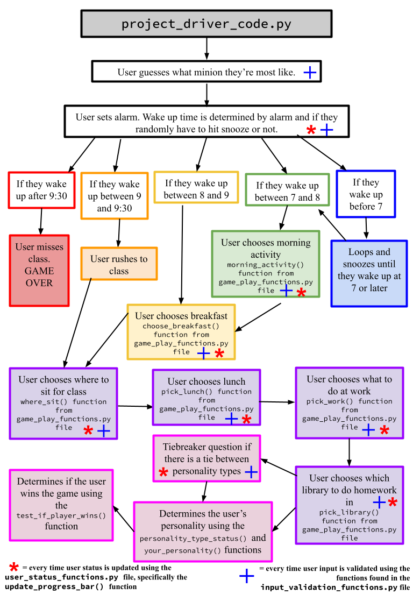

# What minion are you based on your decisions in a day-in-the-life of a college student?

## How to play the game

This game takes you through a day-in-the-life of a college student.
There are multiple decisions to be made each day during the day-in-the-life, and each decision tells you something about your personality.
Based on your decisions during the day-in-the-life, the game will be able to tell you what minion you are most like, either Bob, Stuart, or Kevin.

For each decision that needs to be made in the day (other than specifying the time you want to set your alarm for), you will answer a multiple choice question, and each question has 3 options. Type "a", "b", or "c" to answer each question based on which option you choose.

Before you start the day, you will place your guess of which of the three minions you think you are most like.

You will win the game if the minion you guessed you are most like matches the minion that you are most like based on this day-in-the-life quiz.

You lose if your guess doesn't match the results of the personality test, or if you are late to class.

**To play the game, run the `project_driver_code.py` file**

## How user state is updated

The user's state throughout the game is kept track of by recording and printing how far along they are in the game after every question. The `user_status_functions.py` file has 3 funcitons to keep track of the user's status in this way. The `total_questions_func()` function determines how many questions the user will receive depending on what time they wake up. The `percentage_finished()` function determines the percent of questions that the user has completed. Lastly, the `update_progress_bar()` function uses that percentage to print a progress bar to visualize how much of the quiz the user has completed. 

I chose to represent user state in this way becasue this day-in-the-life activity is in the format of a quiz, so the status of the user in the quiz can be represented through displaying their progress in the game.
I also thought it would be helpful for the user to know how far along in the quiz they are so that they know their status. Instead of just keeping track of the status within the code unitl the end, the code prints the user's status at each step in the game/quiz. I wanted to represent this in a visual way (through the progress bar) so that it is easier for the user to see and understand, and so that they are not overwhelmed with a bunch of text in the game.

## Control Flow

## Functions in each file

### `project_driver_code.py`

This is the file where the game is run from. In addition to containing the driver code, it contains 4 functions that add the personality quiz elements of the game.

The `personality_type_status()` function is how the status of the user in the personality quiz aspect of the game is
updated. This function takes a dictionary of the characters as keys and adds 1 to the value of the character that aligns most with the most recent quiz question. This function is called multiple times throughout the game to 
update the dictionary of characters that the user is most like after each quiz question.

The `your personality()` function takes the dictionary updated throughout the game of the characters that align most with the user's response to each question and finds the personality type with the highest count in that dictionary, which is the personality that user is most like. If there is a tie, the function will return `False`.

The `test_if_player_wins()` function tests if the character that the user guessed they are most like is the same as the character they are actually most like based on the quiz. The function returns a string informing users if they won or lost, what thier guess was, and what character they are most like. 

The `when_wake_up()` function determines what time the user wakes up. This is based on both what time the user set their alarm and if they hit snooze or not. The user does not choose if they want to hit snooze, but rather, the random module is utilized to randomly decide if the user is tired or not in the morning, and if they are, the alarm will snooze. This resembles college mornings becasue when going to bed, a student often doesn't know if they will be tired or not when they wake up in the morning.

### `game_play_functions.py`

This file contains 6 funcitons that run the main games part of the file as a whole. I could have consolidated some of these functions, since they each have the same overall structure, but I didn't want each question to have the same character type associated with each multiple choice response. For exammple, I didn't want every "a" answer in the multiple choice questions to correspond to the same character, since this would make it easier for the user to figure out how to win, and it would make the game less fun. Therefore, I made different functions for each question to keep the results varied.

The `choose_breakfast()` function asks the user what they want to do for breakfast and determines what minion they are most like based on their decisions at breakfast. This function also incorporates randomness becasue if the user choose to go to the campus coffee shop for breakfast, the code will randomly determine how many people are in line and how much time it will take the user to get their breakfast.

The `morning_activity()` function determines what minion the user is most like based on what they choose to for a morning activity. This function incorporates randomness becasue if the user chooses to go to the gym, the code will randomly determine whether or not there are treadmills available for the user to use.

The `where_sit()` function determines the minion the user is most like based on where they sit in class.

The `pick_lunch()` function determines the minion the user is most like based on what they choose to eat for lunch.

The `pick_work()` function determines the minion the user is most like based on what they do at work.

Lastly, the `pick_library()` function determines the minion the user is most like based on which library they choose to study at.

### `input_validation_functions.py`

This file contians 4 functions, each of which validate a different type of user input. 

The `multiple_choice_validation()` function takes a user input that should be either 'a', 'b', or 'c' and validates
this input.

The `character_validation()` input function takes a string inputted by the user and validates that capitalized version
of the input is either 'Bob', 'Kevin', or 'Stuart', which are the three character options for the personality quiz.

The `time_validation()` function ensures that the user is setting their alarm at a valid time. Specifically, when the 
game prompts the user to input the time they want to set their alarm for, this funciton ensures that the number they 
enter is not negative and that it is less than 24, so that they set their alarm within one day.

The `math_question_validation()` validates that the answer a user provides to the math question (which is one of the tiebreaker questions) is an integer, and allows the user to try again if it is not.

### `user_status_functions.py`

As previously described, this file has 3 functions in it, each of which are used to update the user status.

The `total_questions_func()` determines the total nubmer of questions in the quiz based on what time the user wakes up in the game.

The `percentage_finished()` function updates the percentage the user is complete with the game/quiz.

Lastly, the `update_progress_bar()` function prints a progess bar based on the percentage of the game/quiz the user has completed. The progress bar is out of 50 (not 100) so the function converts the percentage from the `percentage_finished()` function to be out of 50.

# Thank you for playing this game!